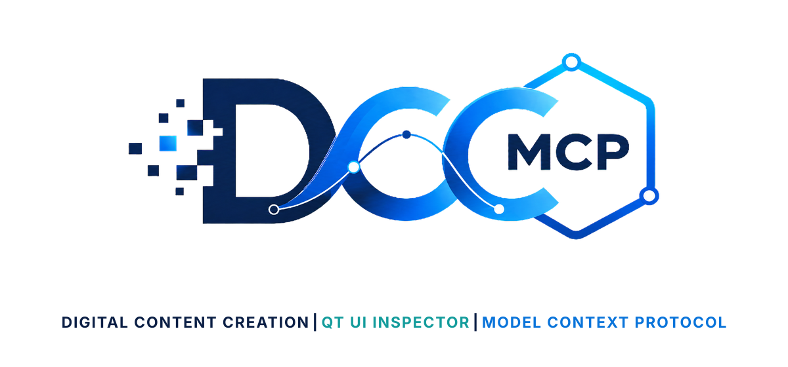
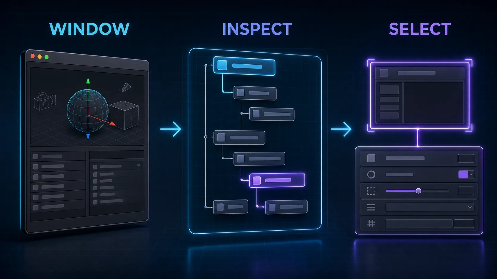

# DCC-MCP Qt UI Inspector

<p align="center">
  
</p>

## Agent workflow

AI agents should use installed package skills through the shared gateway. IDE
users may continue to use the MCP endpoint.

```bash
dcc-mcp-cli dcc-types
dcc-mcp-cli list
dcc-mcp-cli search --query "<task>" --dcc-type <host>
dcc-mcp-cli describe <tool-slug>
dcc-mcp-cli call <tool-slug> --json '{"key":"value"}'
```

If the package skill is not active, call
`dcc-mcp-cli load-skill <skill-name> --dcc-type <host>`. After the task,
query `dcc-mcp-cli stats --range 24h --session-id <task-id>` and pass only
bounded evidence to the `review_skill_improvement` prompt from
`dcc-mcp-skills-creator`.




Reusable Qt UI inspection for DCC-MCP.

This package exposes the core `qt-ui-inspector` skill as an installable
marketplace repo. It is read-only: list Qt windows, find widgets, describe
widgets, snapshot widget trees, and wait for widgets in PySide/PyQt hosts.

## Install

```bash
dcc-mcp-cli marketplace add dcc-mcp/dcc-ui-qt-inspector
dcc-mcp-cli marketplace install dcc-ui-qt-inspector
```

## Tools

- `list_windows`
- `find_widgets`
- `describe_widget`
- `snapshot_tree`
- `wait_for_widget`

Use `dcc-ui-qt-actions` for clicks, text entry, screenshots, and other UI
mutations.
